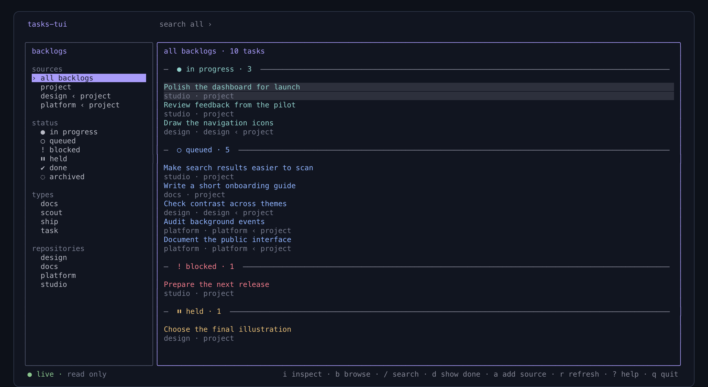
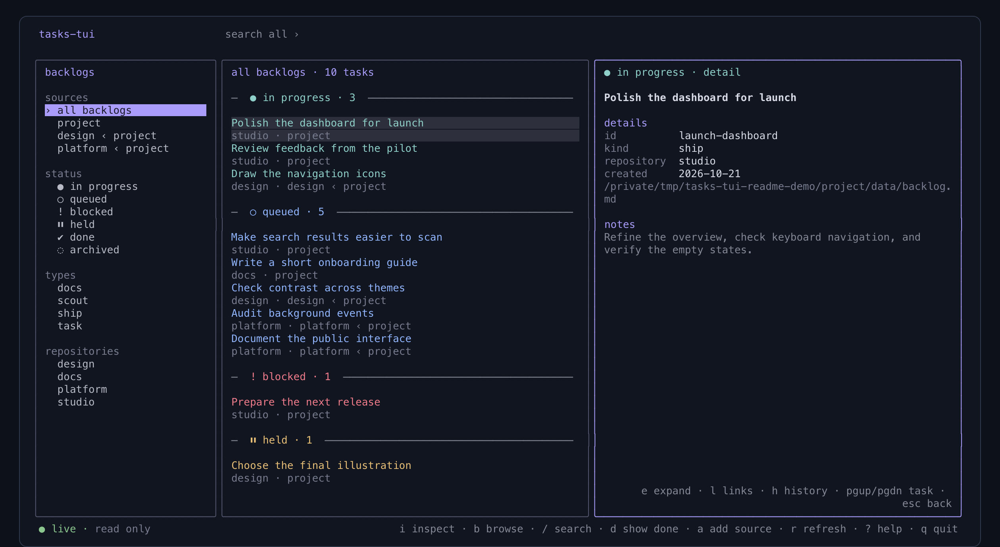

# tasks-tui

A read-only terminal viewer for [tasks-axi](https://github.com/kunchenguid/tasks-axi) backlogs, built with [OpenTUI](https://opentui.com/).

Browse work across backlogs, search task notes, and inspect the context behind a task without leaving the terminal. The Markdown files remain the source of truth; use `tasks-axi` when you want to change them.



## Why

A task's title is only part of the picture. Its status, dependencies, hold reason, notes, and source backlog all help explain what is happening. `tasks-tui` brings those details together in a navigable view while keeping the underlying backlog readable and editable by your existing tools.

## Quick start

You'll need Bun, Node.js 20 or later, Go 1.27.3 or later, and `tasks-axi` on your `PATH`. Install `tasks-axi` if you don't already have it:

```sh
npm install -g tasks-axi
```

From the `tasks-tui` project directory, install the frontend dependencies and build the local backend:

```sh
cd opentui && bun install && cd ..
go build -o bin/tasks-backend .
```

Start the viewer from the project directory:

```sh
./bin/tasks-tui
```

You can also pass one or more backlog files or project directories. Use `--task <id>` to open a task directly; if the id is not found, the viewer displays a warning and opens the task list.

| Usage | Description |
| --- | --- |
| `./bin/tasks-tui [backlog.md | directory ...]` | Open the task list using discovered and specified sources |
| `./bin/tasks-tui --task <id> [backlog.md | directory ...]` | Open the matching task detail, using the specified sources |
| `./bin/tasks-tui --count [backlog.md | directory ...]` | Print the total and counts by status without opening the viewer |
| `./bin/tasks-tui --count --json [backlog.md | directory ...]` | Print total, counts by status, and counts per backlog as JSON |

Press `?` for help, `b` to browse sources and filters, or `/` to search.

## Task counts

`--count` reads the same discovered or explicitly supplied backlogs as the viewer and prints one line with the default visible total (in progress, queued, blocked, and held) and counts for all six statuses: in progress, queued, blocked, held, done, and archived. Add `--json` for machine-readable counts, including `total_all` (including done and archived) and the per-backlog breakdown:

```sh
./bin/tasks-tui --count
./bin/tasks-tui --count --json ~/projects/my-app
```

The short output can be used directly in a panel or status bar, for example `./bin/tasks-tui --count | cut -d '·' -f 1-3`. The JSON output can be consumed by a panel that needs a particular status or backlog. Counting is read-only and does not change backlog files.

## Inspect a task

Select a task and press `i` to open the inspector. On a wide terminal it appears alongside the task list; on a narrow terminal it uses the available space. Switch between details, links, and archived note history without losing the selected task.



- Press `Page Up` or `Page Down` to move to the previous or next task.
- Press `e` to expand the inspector, or `i` to close it.
- Press `l` for links and related tasks, `h` for note history, or `t` to return to details.
- In Links, use the arrow keys to select an entry and `Enter` to open it. Web links open in your browser, local report paths open with your system's default application, and task dependencies open in the viewer.

## Keyboard and mouse

| Key | Action |
| --- | --- |
| `↑` / `↓` | Move between tasks or browse options |
| `Home` / `End` | Go to the first or last item |
| `Page Up` / `Page Down` | Move by page in a list; change task in the inspector or detail view |
| `Enter` | Open a task, choose a browse option, or open a selected link |
| `i` | Open or close the inspector |
| `e` | Expand the inspector |
| `b` | Toggle focus on the browse panel |
| `/` | Search task data across sources and archives |
| `d` | Show or hide completed and archived tasks |
| `a` | Add a backlog file or directory |
| `r` | Refresh sources or reload changed task details |
| `t` / `l` / `h` | Switch to detail, links, or note history |
| `Esc` | Go back or clear the search |
| `?` | Open help |
| `q` / `Ctrl+C` | Quit |

Mouse selection, scrolling, and clickable controls are also supported. The interface adapts to the terminal width: the sidebar and inspector use separate panels when space allows.

## Sources and updates

The viewer discovers backlogs in the current project and within `~/.treehouse`, `~/.fm`, and `~/projects`, with a bounded search depth. Pass paths on the command line or press `a` to add another source. A directory can contain a `backlog.md`, a `data/backlog.md`, or a `.tasks.toml` pointing to its backlog.

The sidebar filters by source, status, task type, or repository. Search scans complete task data across sources and archives. Completed and archived tasks are hidden by default; press `d` to include them or choose their status in Browse.

The view checks for changes every two seconds. An open task keeps its current contents while indicating changed fields; press `r` to reload it. If a known source becomes inaccessible, its last snapshot stays visible and the interface reports `STALE`.

Pruned tasks can be read from `done-archive.md` or the archive configured in `.tasks.toml`. Archived tasks appear in their own group. Older archive entries may not record their original state. Previous note versions are read from `note-archive.md` when available.

## Read-only by design

`tasks-tui` does not create, edit, or change the status of backlog tasks. It saves its own source and view preferences in the operating system's configuration directory. Opening a link delegates to the system's default application.

The viewer currently reads through the installed `tasks-axi` package's Markdown parser and view modules. It therefore requires an installed version that provides those modules; see the [tasks-axi repository](https://github.com/kunchenguid/tasks-axi) for the underlying backlog format and CLI.

## Development

```sh
# Backend checks
go test ./...
go vet ./...

# Frontend checks
bun test
```

The OpenTUI frontend lives in `opentui/`. The Go backend discovers sources, reads snapshots, serves archived note history, and provides task counts. The screenshots above use fictional example tasks.
